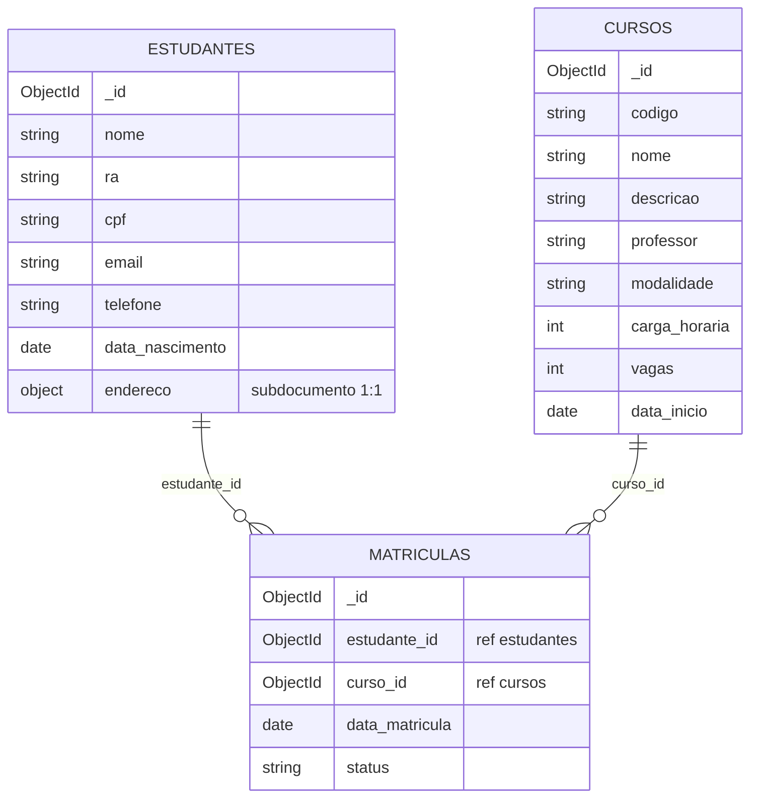

# Cadastro Escolar — PHP + MongoDB

Sistema web de cadastro de **Estudantes**, **Cursos** e **Matrículas**, feito em PHP puro com
a biblioteca oficial `mongodb/mongodb`, interface em **Bootstrap 5** e dados salvos no
**MongoDB** (local ou Atlas).

## Funcionalidades

- **Estudantes** — cadastrar, listar/buscar, ver, editar e excluir.
  - 6 campos: nome, RA, CPF (com validação), e-mail, telefone, data de nascimento.
  - Endereço com 7 campos: CEP, logradouro, número, complemento, bairro, cidade, UF
    (preenchimento automático pelo CEP via ViaCEP).
- **Cursos** — cadastrar, listar/buscar, ver, editar e excluir.
  - 8 campos: código, nome, descrição, professor, modalidade, carga horária, vagas, data de início.
- **Matrículas (N:N)** — um estudante pode se matricular em vários cursos e um curso pode ter
  vários estudantes.
  - Matricular pela tela do estudante, pela tela do curso ou pela tela de matrículas.
  - Status da matrícula: ativa, trancada ou concluída.
  - Controle de vagas (matrículas ativas não podem passar do limite do curso).
  - Impede matrícula duplicada (índice único).
- Painel inicial com totais e ranking de cursos.

## Modelagem dos dados (relacionamentos)

O banco `escola` tem **3 coleções**. Nem tudo é embutido: cada tipo de relação usa a
estratégia adequada.



| Relação | Tipo | Estratégia | Por quê |
|---|---|---|---|
| Estudante → Endereço | 1:1 | **Embutido** (`endereco` dentro do estudante) | O endereço pertence a um único estudante e é sempre lido junto com ele. |
| Estudante ↔ Curso | N:N | **Referenciado** (coleção `matriculas`) | Listas de alunos/cursos crescem sem limite; embutir duplicaria dados e deixaria documentos enormes. A matrícula ainda tem dados próprios (data, status). |

### Exemplos de documentos

`estudantes`
```json
{
  "_id": { "$oid": "665f1a..." },
  "nome": "Ana Beatriz Souza",
  "ra": "RA2026001",
  "cpf": "02595128850",
  "email": "ana1@exemplo.com",
  "telefone": "11999990000",
  "data_nascimento": { "$date": "2000-03-14T00:00:00Z" },
  "endereco": {
    "cep": "01001000",
    "logradouro": "Rua das Flores",
    "numero": "120",
    "complemento": "",
    "bairro": "Centro",
    "cidade": "São Paulo",
    "estado": "SP"
  }
}
```

`cursos`
```json
{
  "_id": { "$oid": "665f1b..." },
  "codigo": "MDB-201",
  "nome": "MongoDB na Prática",
  "descricao": "Modelagem de documentos, índices, agregações e relacionamentos.",
  "professor": "Profa. Júlia Costa",
  "modalidade": "EAD",
  "carga_horaria": 40,
  "vagas": 50,
  "data_inicio": { "$date": "2027-02-15T00:00:00Z" }
}
```

`matriculas`
```json
{
  "_id": { "$oid": "665f1c..." },
  "estudante_id": { "$oid": "665f1a..." },
  "curso_id": { "$oid": "665f1b..." },
  "data_matricula": { "$date": "2026-11-18T22:00:00Z" },
  "status": "ativa"
}
```

### Como as coleções são "juntadas"

As telas usam o pipeline de agregação com `$lookup` (equivalente ao JOIN do SQL), por exemplo
em `src/MatriculaRepository.php`:

```php
$colecao->aggregate([
    ['$match'  => ['curso_id' => $cursoId]],
    ['$lookup' => ['from' => 'estudantes', 'localField' => 'estudante_id', 'foreignField' => '_id', 'as' => 'estudante']],
    ['$unwind' => '$estudante'],
    ['$lookup' => ['from' => 'cursos', 'localField' => 'curso_id', 'foreignField' => '_id', 'as' => 'curso']],
    ['$unwind' => '$curso'],
]);
```

### Integridade

- Índices únicos: `estudantes.cpf`, `estudantes.email`, `estudantes.ra`, `cursos.codigo` e
  `matriculas (estudante_id, curso_id)`.
- Ao excluir um estudante ou curso, as matrículas ligadas a ele também são excluídas
  (não ficam referências órfãs).

## Estrutura de pastas

```
├── bin/seed.php               # popula o banco com dados de exemplo
├── public/                    # raiz do servidor web
│   ├── index.php              # painel
│   ├── estudantes/            # index, form, ver, excluir
│   ├── cursos/                # index, form, ver, excluir
│   └── matriculas/            # index, salvar, status, excluir
├── src/
│   ├── bootstrap.php          # autoload, .env, sessão
│   ├── Database.php           # conexão e índices
│   ├── EstudanteRepository.php
│   ├── CursoRepository.php
│   ├── MatriculaRepository.php
│   └── helpers.php
├── templates/                 # cabeçalho, rodapé e partes reutilizáveis
├── .env.example
├── composer.json
└── docker-compose.yml         # MongoDB local opcional
```

## Como executar

### 1. Pré-requisitos

- PHP 8.1 ou superior
- [Composer](https://getcomposer.org/)
- Extensão **mongodb** do PHP
  - Linux/macOS: `sudo pecl install mongodb` e adicione `extension=mongodb` ao `php.ini`
  - Windows (XAMPP/WAMP): baixe a DLL compatível com sua versão do PHP (Thread Safe, x64) em
    <https://github.com/mongodb/mongo-php-driver/releases>, copie `php_mongodb.dll` para
    `php/ext` e adicione `extension=mongodb` ao `php.ini`
  - Confira com `php -m | grep mongodb` (Windows: `php -m | findstr mongodb`)

### 2. Banco de dados (escolha um)

**Local com Docker**
```bash
docker compose up -d
```

**Local instalado** — instale o MongoDB Community Server e deixe-o rodando na porta 27017.

**MongoDB Atlas (nuvem)**
1. Crie um cluster gratuito (M0) em <https://www.mongodb.com/cloud/atlas>.
2. Em *Database Access*, crie um usuário e senha.
3. Em *Network Access*, libere o seu IP (ou `0.0.0.0/0` para testes).
4. Em *Connect → Drivers*, copie a string `mongodb+srv://...`.

### 3. Instalar e configurar

```bash
composer install
cp .env.example .env      # Windows: copy .env.example .env
```

Edite o `.env` com a sua conexão:

```
MONGODB_URI=mongodb://localhost:27017
MONGODB_DB=escola
```

### 4. (Opcional) Dados de exemplo

```bash
php bin/seed.php            # insere 6 estudantes, 5 cursos e matrículas
php bin/seed.php --limpar   # apaga tudo e insere de novo
```

### 5. Rodar

```bash
php -S localhost:8000 -t public
```

Acesse <http://localhost:8000>.

> No XAMPP/WAMP, coloque a pasta em `htdocs` e acesse
> `http://localhost/cadastro-escolar-mongodb/public/`.

## Tecnologias

- PHP 8 + [MongoDB PHP Library](https://www.mongodb.com/docs/php-library/current/)
- MongoDB (local ou Atlas)
- Bootstrap 5 e Bootstrap Icons (via CDN)
- ViaCEP para preencher o endereço
